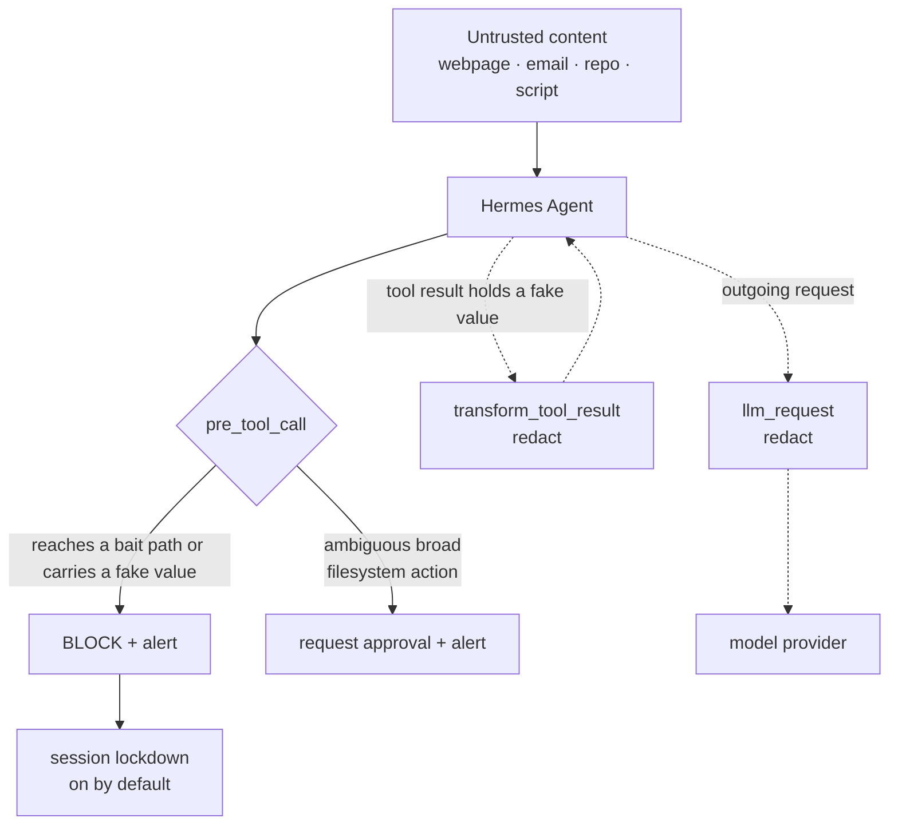

# customs

**Catch your agent reaching for credentials it should never touch.**

An agent with a shell reads a lot of text it didn't write: web pages, emails, issues, install scripts. Hidden in any of
it can be a line meant only for the agent, telling it to go find your keys and send them somewhere. A careful agent
ignores that. A hijacked one starts hunting through your home folder, and you usually find out too late.

customs plants fake credential files where that hunt would land, then watches the agent's tool calls. The moment a call
reaches for one of those files, customs stops it before the tool runs. Credential reconnaissance becomes a visible
incident instead of a secret you notice missing after it's already gone. It also strips its own fake values out of tool
results and out of the request on its way to the model provider, so a value that slips through another route still
doesn't travel.

The distinction worth holding onto: customs watches for the attempted search, not just the eventual leak.

> Know the boundary: customs only recognizes its own bait paths and the fake values it generated. It does not discover,
> protect, encrypt, or monitor your real credentials. It is a tripwire and an alarm inside the agent loop, not a vault or
> an operating-system security boundary.

[Install](#install) · [See it work](#see-it-work) · [Why it matters](#why-it-matters) · [How it works](#how-it-works) ·
[How it differs](#how-it-differs) · [Commands](#commands) · [Configuration](#configuration) ·
[Limitations](#limitations) · [Security disclosure](#security-disclosure) · [Test it](#test-it)

## See it work

You need Hermes Agent 0.23.0 or later, with customs installed and enabled.

### 1. Plant decoys

In a Hermes chat:

```text
/customs plant
```

The default set creates six decoy files: one each for environment variables, AWS credentials, an SSH private key,
database credentials, JSON configuration, and a GitHub token note. File names and locations are selected on your
machine.

### 2. Simulate a credential hunt

Copy one of the reported bait paths and ask the agent:

> Show me what's inside this file: `<bait path>`

customs intercepts the matching tool call before it runs. The agent receives a block message, an incident is recorded,
and the user is alerted in the chat. With the default lockdown setting, network actions in that session require
approval until you unlock it.

### 3. Inspect the incident

```text
/customs incidents
```

The incident shows the rule that fired, the bait file involved, the likely source where available, and a short redacted
preview of the attempted call. The incident log does not store the fake credential value, file contents, or full tool
arguments.

When finished:

```text
/customs unlock
/customs unplant
```

`unlock` ends the session lockdown. `unplant` removes customs' bait files, subject to its safety checks.

## Why it matters

An agent can encounter instructions in material the user did not write: a webpage, email, issue, README, cloned
repository, or install script.

That material might tell the agent to search the home directory for credentials and upload what it finds. The agent
may then use an ordinary filesystem or shell tool to carry out the request.

The risk is not limited to the final answer. A secret can be sent directly from a shell command, encoded before
transmission, or handled by a tool without ever appearing in the assistant's visible response.

Secret masking helps, but it is not the same as detecting the attempted reconnaissance. A decoy file gives customs a
specific signal: **the agent is reaching for something that should not be needed.**

## How it works



### 1. Decoys that live on disk

`/customs plant` creates fake credential files in plausible locations under your home directory. The values are
generated locally, so installations do not share the same bait values.

The default set covers six common credential-file formats:

- Environment-file credentials.
- AWS credentials.
- SSH private-key material.
- Database credentials.
- JSON configuration credentials.
- A GitHub token note.

`/customs blend` can place bait in locations that fit the folder structure already present under your home directory.
It reads folder names only, up to 3 levels deep; use `--preview` to inspect the proposed placements without creating
files.

customs avoids overwriting existing files, avoids names that tools commonly load automatically, stays within the home
directory, and applies additional safeguards when planting inside Git repositories.

### 2. Interception before tool execution

customs registers a `pre_tool_call` hook. It examines the proposed tool call before the underlying tool runs.

It recognizes bait access through supported file-tool, shell, glob, nested-shell, and code patterns. Examples include:

- Reading or writing a bait path through a file tool.
- Using shell commands such as `cat`, `head`, `cp`, or `scp` on a bait path.
- Sending a bait file directly through a command such as `curl`.
- Reaching a bait file through a matching wildcard.
- Changing into a bait file's directory and referring to the file by name.
- Referencing a bait path in supported nested-shell or code-tool calls.

A matching access attempt is blocked before that tool call executes. Broader or ambiguous operations, such as certain
archive, sync, or search operations near bait files, are escalated to Hermes approval instead of being treated as a
confirmed credential access attempt.

This distinction matters: customs does not need to wait for a fake value to appear in the agent's answer before raising
an incident.

### 3. A second boundary: fake-value redaction

A bait path can be reached through a route that does not produce the expected direct path match. customs therefore
also tracks the fake values it generated.

It checks tool arguments, tool results, and outgoing model-provider requests for those values in plain form, any run of
16 or more of their characters, and their base64, base64url, hex, URL-encoded, and reversed forms. A match in tool
arguments blocks the call; a match in a tool result or a provider request is replaced with `[customs: protected]`
before it goes further.

The outgoing-request check matters because protecting only the final assistant response would be too late: the
sensitive-looking value could already have been included in a request to the model provider.

customs checks for its own generated values, not arbitrary secrets belonging to the user.

### 4. Script inspection

When a command is about to run a local script (through a shell, Python, Node, `./script`, or an npm, pnpm, or yarn
script), customs reads the script text before execution, plus one level of scripts it calls: up to 8 files, 512 KB
each.

A script pattern that combines credential-file hunting with an upload is blocked. A pattern that appears to hunt for
credentials without a detected upload is escalated for approval. Commands that pipe downloaded content directly into a
shell require approval because the payload cannot be inspected in advance.

This is static pattern analysis, not a sandbox. It cannot prove what arbitrary code will do at runtime.

### 5. Session lockdown and incident records

With the default lockdown setting enabled, a block places the session into lockdown. Network actions in that session
require user approval until `/customs unlock` is used.

A `post_tool_call` hook keeps a short list of the untrusted things each session read (web pages, browser pages,
downloads, cloned repositories). Each incident records useful investigative context: the tool, detection rule, bait
file, a short redacted call preview, and the likely untrusted source when customs can associate one. A script with no
plausible link to a source is recorded as local.

The incident log is designed to record the event without storing the fake value, file contents, or full tool
arguments.

## How it differs

Decoy credentials are an established defensive technique. customs' contribution is where it places the decoys and where
it watches for their use: **machine-local files monitored from inside the Hermes agent's tool loop.**

### Compared with conversation-based decoys

A conversation-based decoy can help identify an agent that repeats or forwards a planted string. But a string in chat
is not a file in the user's home directory.

customs plants files on disk. That lets it detect supported attempts to search for or access those bait paths,
including attempts that occur before a credential value is read.

The approaches address different observation points and can be complementary.

### Compared with callback-based honeytokens

Services such as Thinkst Canarytokens and Tracebit provide honeytoken approaches that can alert when a planted token is
used against a monitored service.

customs is designed to detect a different stage: supported access attempts inside the Hermes tool loop, before a bait
value is sent onward. Its default operation does not depend on a token calling home.

These approaches can complement one another. A callback-based token may observe activity outside Hermes; customs focuses
on the agent's own tool interactions.

## Commands

All commands use the `/customs` chat command:

| Command | What it does |
| --- | --- |
| `/customs plant` | Plants the default set: one bait file of each of the six types. Types whose bait is still in place are left alone. |
| `/customs plant <N>` | Plants N bait files with random types, names, and folders. |
| `/customs blend <N> [--preview]` | Plans or plants N bait files in locations that fit existing project folders. Preview creates nothing. |
| `/customs add <path> [--type T]` | Plants one bait file at a chosen path. Types: `env`, `aws`, `ssh`, `db`, `json`, `github`. |
| `/customs status` | Shows each bait file's state (in place, missing, changed, not ours) and the lockdown state. |
| `/customs incidents [N]` | Shows the latest N incidents (10 by default), newest first. |
| `/customs unplant [path]` | Removes one bait file or all bait files, subject to safety checks. |
| `/customs unlock` | Ends the current session's lockdown. |
| `/customs check` | Read-only health check: whether the bait registry loads, what is being watched, bait file states, push alert and lockdown settings, logged errors, and a detector self-test on made-up cases. It plants nothing, changes no file, and sends nothing. |

### Planting safeguards

customs is designed to avoid disrupting normal development:

- It does not overwrite an existing file.
- It avoids names that tools commonly load automatically, such as `.env`, `.npmrc`, `id_rsa`, and `credentials`.
- It keeps planted files inside the user's home directory.
- Inside a Git repository, it plants only where Git already ignores the target path.
- It caps the number of bait files at 100.
- A bait file changed since planting is not blindly removed by `unplant`.

## Install

Requirements: Hermes Agent 0.23.0 or later. customs uses the Python standard library.

```bash
hermes plugins install pgreyy/customs
hermes plugins enable customs
hermes gateway restart
```

Restart the gateway if you use Hermes through the messaging gateway.

Then plant the default decoys:

```text
/customs plant
```

## Configuration

Both settings live under `plugins.entries.customs.settings` in the Hermes configuration. Edit it with:

```bash
hermes config edit
```

Example:

```yaml
plugins:
  entries:
    customs:
      settings:
        lockdown: true
        alert_target: ""
```

| Setting | Default | What it does |
| --- | --- | --- |
| `lockdown` | `true` | After a block, network actions in that session (web and browser tools, and shell commands such as `curl`, `ssh`, or `git push`) require Hermes approval until `/customs unlock`. The lockdown is saved in the plugin's data folder, so it still applies if the same session continues after a Hermes restart; a new session starts unlocked. Saved lockdowns older than 30 days are dropped when Hermes starts. |
| `alert_target` | `""` (off) | Optional push alert target, such as `telegram` or `telegram:<chat id>`. When configured, customs sends alerts through `hermes send`, at most one per session every 30 seconds. |

Without `alert_target`, alerts appear only in the chat where the incident occurred.

**Network behavior:** customs makes no network calls by default. Setting `alert_target` is the opt-in exception;
notifications use the user's existing Hermes messaging setup. A push alert contains the rule that fired, the bait
file's path, the likely source, and a masked preview of the call (up to 200 characters). Bait values, file contents,
and full tool arguments are not sent.

## Limitations

customs is deliberately narrow. Understand these boundaries before relying on it:

- **It only catches what touches its bait.** An agent that goes directly to a real credential and never touches a bait
  path or a generated fake value can evade detection.
- **It does not protect real credentials.** It does not encrypt, move, permission, or monitor real secrets. Continue
  using operating-system permissions and Hermes' own secret-redaction features.
- **It observes the Hermes tool loop, not the whole machine.** Activity by unrelated programs, background processes
  outside the observed hooks, or other operating-system processes may be outside its view.
- **Some detection is static.** A path assembled dynamically, a payload downloaded after inspection, or behavior hidden
  behind runtime indirection may not be detected. A search that only lists file names is not blocked.
- **Script inspection is not isolation.** Reading script text before execution does not make arbitrary code safe.
- **Some broad operations require judgment.** Approval-required actions are not automatically prevented if the user
  approves them.
- **Source attribution is best-effort.** customs can identify a likely untrusted source when the session's observed
  history supports one; not every incident has a provable source.
- **It fails open on its own errors.** If customs hits an internal error while checking a call, it lets that call
  through and writes the error to its error log, because a crash inside a `pre_tool_call` hook would otherwise block
  every tool call. A bait registry that can't be read when Hermes starts means nothing is watched until it is fixed.
  `/customs check` reports both.

Use customs as one layer in a defense-in-depth setup, not as a substitute for credential hygiene, least privilege,
filesystem permissions, or endpoint security.

## Security disclosure

| Category | Behavior |
| --- | --- |
| Reads | Tool arguments and results passed through its hooks, and outgoing model-provider requests, in memory; its own state and error log; bait files it planted; local scripts a command is about to run (up to 8 files, 512 KB each); and folder names under the home directory during `/customs blend`. |
| Writes | Bait files it plants (mode 600, new parent folders 700); and its own registry, incident log, error log, likely-source list, and lockdown state in the Hermes plugin data directory (mode 600). |
| Executes | `git check-ignore` when checking whether a target inside a Git repository is ignored; `hermes send` only when `alert_target` is configured. |
| Network | None by default. Optional alerts use the user's configured Hermes messaging route and carry the rule, the bait file's path, the likely source, and a masked call preview. |
| Incident retention | Incident records do not store fake values, file contents, or full tool arguments. |

## Test it

Clone the repository and run the detector's sample checks:

```bash
git clone https://github.com/pgreyy/customs
cd customs
python3 scripts/detect_samples.py
```

The sample script feeds made-up inputs to the detectors as strings; it does not execute scripts, plant bait, or write
files. The expected result is `10/10 as expected.`:

- Scripts: a credential hunt followed by upload is blocked, a hunt without a detected upload requires approval, and a
  harmless setup step is allowed.
- Tool calls against a made-up bait path: a direct read with a file tool and a `curl` upload of the file are blocked,
  archiving the folder that holds it requires approval, and a harmless command is allowed.
- Fake values: a base64-encoded value and a 16-character fragment are found; ordinary text is not.

Validate the plugin with Hermes installed:

```bash
hermes plugins validate .
```

In a Hermes chat, `/customs check` runs a similar self-test against the live plugin.

For contributions, please add a sample to `scripts/detect_samples.py` for both a detection and a safe, allowed case.

## Licence

[](https://github.com/NousResearch/hermes-agent) [](#security-disclosure) [](LICENSE)

Licensed under the MIT licence. See [LICENSE](LICENSE). Copyright 2026 pgreyy.

Unless stated otherwise, contributions submitted for inclusion are licensed under the same terms.
